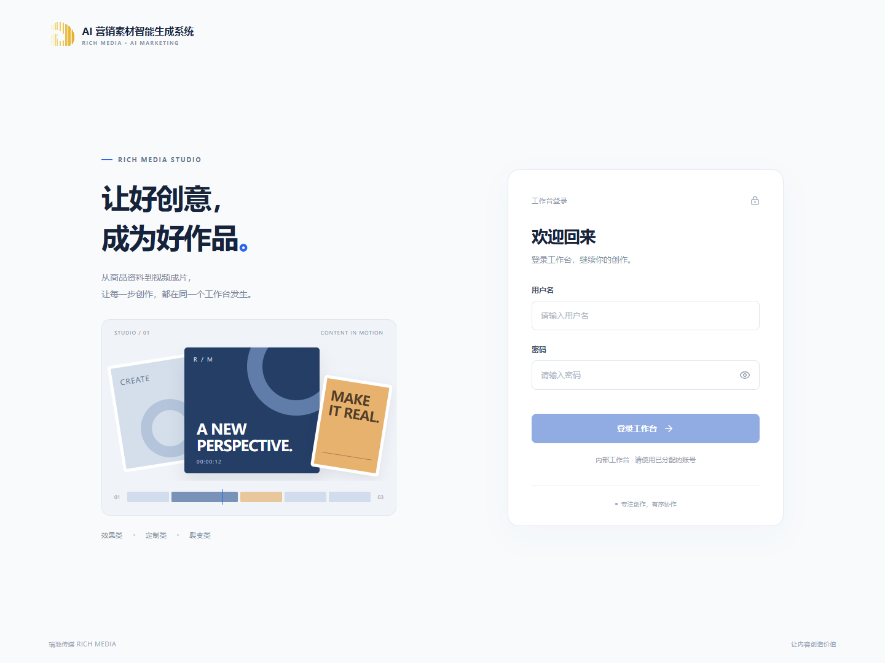

# 2026-10-29 新工作目录静态前端发布验证

## 结果与范围

用户授权用一个小改动验证迁移后的上线路径。本次从 `D:\1Code\cyl\ai-marketing-platform` 构建并经 SSH 上传静态前端，公网浏览器已确认生效。

- 工作区：`main`，基线 `ff69df9`（工程：初始化AI营销素材平台接手仓库），执行前干净。
- 本地 origin：`https://github.com/1saachen/ai-marketing-platform.git`。
- 唯一产品变更：[LoginPage.vue](../../../../../apps/web/src/platform/auth/LoginPage.vue) 的提示从“登录账号，继续你的创作。”调整为“登录工作台，继续你的创作。”。
- 线上入口：[营销工作台](https://marketing.richbest.cn)。发布标识：`web-20261029-ff69df9-login-copy`；该标识代表基线加未提交的文案改动，不代表一个新 Git 提交。
- 实际更新范围：Web 静态资源、首页入口及服务器对应的登录页源码。API、Worker、模型参数、生产环境配置和数据库结构未修改。
- 发布脚本记录容器身份、镜像 ID、启动时间及任务状态统计，发布前后相同。此次没有执行生成、包装、渲染或导出任务。

## 迁移影响核对

本地目录和 origin 改动不会自行更新运行容器。现场观察到 API 和 8 个 Worker 仍运行 `20261020-7589ee93` 镜像，健康接口返回 200。

服务器 `/opt/ai-marketing-platform` 当前不是 Git 工作区；Web 通过目录绑定挂载 `apps/web/dist`。因此本次可继续使用构建产物上传方式，不依赖服务器从新仓库拉取。未发现当前仓库中的 `.github` 自动发布配置。

本地复制的 `node_modules/.modules.yaml` 仍指向旧目录；已按锁文件重建，虚拟依赖目录改为当前工作目录。在正常主机权限下执行 `pnpm --filter @ai-marketing/web exec node -p 'process.cwd()'` 成功返回新目录。随安装运行的 `prisma generate` 只生成本地客户端，没有应用数据库迁移。

本机工具环境实际提供 pnpm 11.25.0，仓库声明 10.33.0；本次未修改声明或锁文件，生产构建使用安装后的本地工具直接执行。受限沙箱与普通主机的依赖缓存路径不同，沙箱内 pnpm 自动校验曾要求重新安装，因此不能把沙箱报错直接视为普通终端也不可用。后续固定构建环境时应遵循项目声明的版本。

已比对服务器上 536 个 Web、UI、Contracts 源码及相关构建配置文件，归一化文本换行后，除授权文案外一致；PNG 另以原始字节 SHA-256 核对一致。未据此宣称 API/Worker 全部源码已比对。

首次执行 `git ls-remote --heads origin main` 时，本机连接 GitHub 443 失败。随后重新验证成功：GitHub HTTPS 返回 200，远程 `main` 指向 `ff69df9680116bc7859f58543822f1490d4b0d9c`，确认本机已能读取新仓库。该检查不代表服务器取码、CI 或全量后端部署已验证；后续改用这些发布方式时，仍需核对授权、分支、Secrets 和发布来源。

## 已执行检查

以下命令中 `node` 使用当前环境提供的 Node.js 24.19.0。

```powershell
pnpm install --frozen-lockfile --ignore-scripts
node node_modules/typescript/bin/tsc -p packages/contracts/tsconfig.json
node apps/web/node_modules/vue-tsc/bin/vue-tsc.js -p apps/web/tsconfig.app.json --noEmit
node apps/web/node_modules/vite/bin/vite.js build apps/web
node node_modules/vitest/vitest.mjs run --root apps/web --maxWorkers=1 src/api/http-client.spec.ts src/platform/health/api/health.api.spec.ts
node node_modules/prettier/bin/prettier.cjs --check apps/web/src/platform/auth/LoginPage.vue
node node_modules/eslint/bin/eslint.js apps/web/src/platform/auth/LoginPage.vue
git diff --check
```

类型检查、构建、Lint、格式及空白检查通过；相关单测 2 个文件、29 项通过。构建保留既有的大包体积警告。未运行全工作区门禁、API/Worker 测试或付费端到端测试。

浏览器最终使用已安装的 Chrome 156.0.8078.49：

- 本地构建和公网各覆盖 1920、1440、390 宽度：新文案正确、匿名表单显示、空表单按钮禁用、无横向溢出、刷新恢复、无页面 JavaScript 异常；390 宽度另断言单列布局及隐藏装饰插画。
- 本地隔离网络响应另覆盖会话加载、错误提示及点击重新连接后恢复。该部分使用显式测试响应，不代表线上真实错误或登录鉴权已重新验收。
- 初次使用 Edge 100.0.1185.36 时发现它不支持构建 CSS 中的媒体查询范围语法。已确认旧线上 CSS 同样使用该语法；废弃该窄屏结论，改用 Chrome 重测，并覆盖原截图。没有将修复旧浏览器兼容性纳入此次变更。
- 公网 `/api/health` 返回 200，响应 `data.status` 为 `ok`。

结果文件：[本地](local-results.json)、[公网](live-results.json)。

## 备份、切换与恢复位置

发布前确认数据库中没有 QUEUED/RUNNING 任务，152 条 Outbox 均为 PUBLISHED，八个队列 ready/unacknowledged 均为 0、各有 1 个消费者。PARTIAL 和 PENDING_RENDER 为已有业务状态，不据此触发生成或导出。

- 数据库备份：服务器 `backups/ai-marketing-20261029T014305Z.sql.gz`，既有备份脚本压缩校验通过。
- 发布记录目录：服务器 `/opt/ai-marketing-platform/deployment-logs/web-20261029-ff69df9-login-copy/`。
- 旧静态文件：上述目录的 `previous-dist/`；旧登录源码：`previous-LoginPage.vue`；状态记录：`release.json`。
- 静态包 SHA-256：`ae546b69071acf2be6c93843bcff7cd21759e90fc8a0318c08104293e0b56d3e`。
- 新首页引用 `/assets/index-CodERi1-.js`；旧入口引用 `/assets/index-Bl0gjSAy.js`。旧哈希资源保留，避免已打开页面失去资源。
- 切换通过原目录内临时文件替换完成，保留绑定挂载的目录本身；本机 HTTP 和 API 健康检查通过，随后完成公网浏览器复核。

如需回退这次文案，在确认没有后续发布后，将 `previous-dist/index.html` 和 `previous-LoginPage.vue` 分别原子恢复到正式首页与源码位置即可；旧静态资源仍在。备份已生成，但本次没有执行数据库恢复演练。

## 公网页面截图




