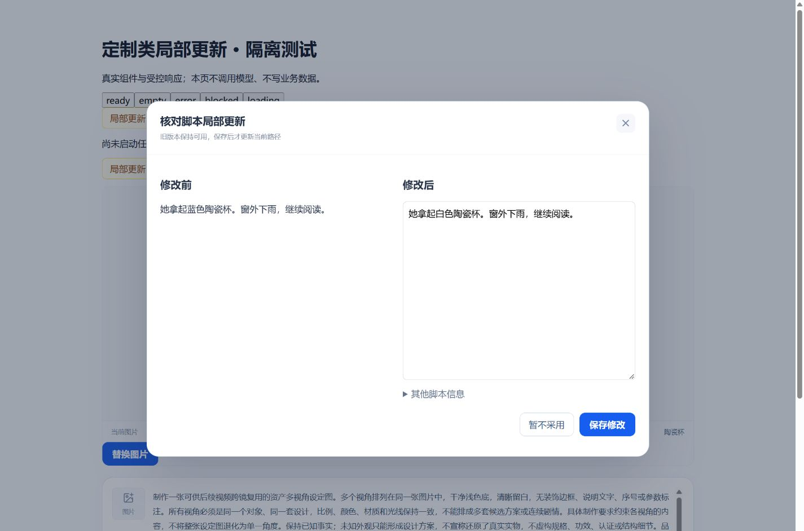

# 定制类局部更新与资产上传替换验证

日期：2026-10-29。作用域：当前工作区源码，定制类五节点。依据：[已确认计划](../plans/2026-10-29-局部更新与资产上传替换.md)。本记录区分源码检查、受控测试和未执行的运行验收，不把模拟候选当作真实模型效果。

后续同日按用户要求恢复本地环境，Web/API/四个定制 Worker 已运行，补跑一个局部更新数据库测试通过；其余原始验证限制保留。实际配置、启动方式和补跑范围见[本地启动记录](../../../development/evidence/2026-10-29-local-startup.md)。

## 实现范围

- 共用契约增加局部更新预览、版本化输入、脚本精确文本补丁和候选。API 读取当前项目/Run 的来源、工作副本与草稿，返回依赖层面的可能影响范围；启动时重新校验预览指纹，冲突要求重新预览。预览不调用模型。
- 信息卡局部提炼保留人工覆盖，并提示核对与新结果的差异。同策略、同固定文件版本只复用文档级提取，仍对当前全部资料融合、审校，人工确认后提交。
- 脚本定向改稿复用既有任务、阶段与检查点，保留旧新信息卡和原脚本；独立审校通过只产生候选。对比、编辑并保存才提交当前路径，不自动创建脚本分支。基线或旧窗口冲突时拒绝覆盖。
- 资产整理局部更新原位提交，保留对象身份、人工字段和已采用图片。分镜更新读取完整上下文，声明实际改动与衔接原因，验证未改范围、稳定身份及冻结引用。不能可靠局部处理的历史基线明确要求人工编辑或本节点重生成。
- Prompt/视频按服务端冻结的目标集合创建既有逐片段任务，刷新恢复任务范围与真实进度；失败保留旧产物及成功项。源码没有添加全片合成或裂变流程。
- 单资产图片窗口增加上传/替换，支持 PNG/JPG/WebP、不超过 10 MB。上传先进入编辑草稿，取消恢复原绑定，保存才生效。校验固定项目资产与文件版本，同内容替换优先复用原版本，附属对象继续使用现有主体归属。
- 仅在能够证明分镜/提示词/实际渲染输入未变时同步依赖，不增加内容 revision。真实图片版本变化按渲染参考图关联标记视频待更新；旧文件不因来源变化而被删除或隐藏。图片视觉定义变化保留旧图并提示核对。

未新增数据库表或迁移，新增执行信息放入既有可选 JSON；没有自动提交、推送、创建 PR、重启用户服务或触发付费任务。

## 自动化验证

以下命令已实际执行。单测使用受控依赖，不等于真实数据库或供应商验收。

| 检查            | 命令或范围                                                                                                                                                                               | 结果                                               |
| --------------- | ---------------------------------------------------------------------------------------------------------------------------------------------------------------------------------------- | -------------------------------------------------- |
| Contracts       | `pnpm --filter @ai-marketing/contracts test`                                                                                                                                             | 32 文件、350 项通过                                |
| 定制类 API      | `pnpm --filter @ai-marketing/api exec vitest run src/workflows/customized/production src/workflows/customized/storyboard src/workflows/customized/information-extraction --maxWorkers=1` | 24 文件通过、16 文件跳过；138 项通过、19 项跳过    |
| 定制类 Web      | `pnpm --filter @ai-marketing/web exec vitest run src/workflows/customized --maxWorkers=1`                                                                                                | 33 文件、251 项通过                                |
| TypeScript      | `pnpm typecheck`；最后增加测试后另执行 API typecheck                                                                                                                                     | 通过                                               |
| 生产构建        | `pnpm build`                                                                                                                                                                             | 通过；Vite 保留大体积 chunk 提示，不代表服务已更新 |
| Worker 测试     | customized-extraction、customized-storyboard、customized-assets、customized-production 各自 `tests`                                                                                      | 四套均通过                                         |
| Worker 静态检查 | 四个 Worker 的 mypy；制作检查包含 shared/customized-production-runtime                                                                                                                   | 均通过                                             |
| 格式与 Lint     | 变更 TS/Vue 文件 ESLint；变更文本 Prettier                                                                                                                                               | 通过                                               |
| 补丁空白        | `git -c core.autocrlf=false diff --check`                                                                                                                                                | 通过                                               |

关键新增测试覆盖：补丁唯一原文定位/身份与非法路径保护、候选与发布边界、审校哈希和越界结果、预览指纹、同输入媒体依赖同步、文件固定版本/来源、视觉定义依据、同图上传复用、迟到上传和超限图片。新增数据库用例包含连续两轮来源变化、同内容 revision 与兄弟路径隔离，但本轮没有可用数据库，未运行该用例，不将这些并发/持久化场景记为集成通过。

Contracts 原脚本默认会在构建后同时收集 `dist` 内 CommonJS 测试副本。本轮将测试范围限定为 `src` 后执行上述完整源码测试，未删除测试或屏蔽失败断言。

### Python 执行环境

本机 `uv` 不可用，四个已有 `.venv` 的 Python 入口引用另一台机器的基路径。使用桌面内置 Python 3.12.14，加载各 Worker 已有 `.venv/Lib/site-packages` 和本仓库共享源码后执行 pytest/mypy；没有安装依赖、更新锁文件或连接模型。可在恢复正常虚拟环境后按各 Worker README 的常规命令复跑。

实际测试启动方式为下面的引导脚本，将 `<worker>` 替换为上述四个目录名；静态检查同样使用该解释器及所属 `pyproject.toml`，通过 `MYPYPATH`/`PYTHONPATH` 指向对应源码和依赖。

```python
import site, sys
site.addsitedir('workers/<worker>/.venv/Lib/site-packages')
sys.path[:0] = [
    'workers/<worker>/src',
    'workers/shared/customized-production-runtime/src',
    'workers/shared/ai-runtime/src',
    'workers/shared/extraction-runtime/src',
]
import pytest
sys.exit(pytest.main(['-q', 'workers/<worker>/tests']))
```

## 浏览器受控回归

使用 `apps/web/tests/browser/customized-update.html` 和 `customized-update-fixture.ts` 隔离夹具，实际挂载正式新增组件，只拦截合成测试项目请求。候选以 sessionStorage 模拟服务端恢复；图片通过真实文件选择器上传测试 PNG。没有访问真实项目写接口或发起模型请求。该夹具用于 UI 状态和交互验证，不能证明 PostgreSQL 持久化、租约并发、真实存储或服务重启恢复。

已操作并观察：

- 更新预览：正常、空范围、错误重试、阻断和加载状态；空/加载/阻断时不能确认。
- 脚本：生成模拟候选、前后对比、编辑后不采用、刷新恢复原候选、再次编辑并明确保存。
- 图片：文件选择、草稿预览、取消恢复原绑定、再次上传并保存；上传操作不触发生成。
- 宽度：1920、1440、390；窄屏可滚动阅读，操作区可见；最终控制台错误为空。

截图为 2026-10-29 的合成数据 UI，不是生成质量或正式项目成果：



[1920 宽截图](browser/2026-10-29-local-update/script-review-1920.jpg) · [390 窄屏截图](browser/2026-10-29-local-update/script-review-390.jpg)

隔离 Vite 使用端口 5196，回归结束后已停止，浏览器测试标签已关闭并重置 viewport。没有重启 API/Worker 或变更用户现有服务。

## 未验证范围与运行限制

- 只读数据库连通检查失败，Docker daemon 也不可用。没有启动 Docker，避免恢复未知队列中的任务。19 项数据库测试按现有环境开关跳过；跨分支事务、迟到回调竞争、真实持久化及中断恢复仍需数据库环境验证。
- 未执行真实 Ark/Seedance/TTS/音乐调用；脚本语义修改质量、资产连续性、实际渲染画面及真实视频播放下载未在本轮付费复测。旧视频保留在契约/API 层受控测试中验证，不等于真实成片验收。
- 未部署或重启服务；构建产物通过不代表正在运行的服务已经使用新代码。运行联调需按本地开发指南先核对活动任务，再更新并检查实际代码生效。
- 当前结论是源码与受控验证完成，数据库及真实付费端到端验收尚未完成；数量、性能、首发率与画面质量没有新增达标结论。
