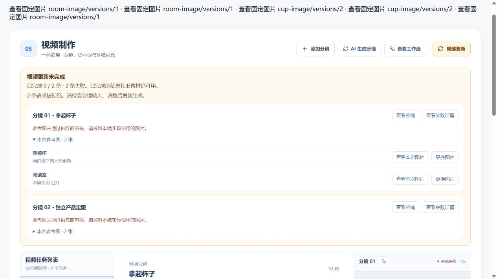

# 视频失败定位与批次进度验证

## 本轮范围

2026-11-11，定制类视频制作节点。失败批次列出对应分镜及该次任务实际使用的固定参考图，支持图片预览和所属资产定位。单镜重新生成后的当前有效结果用于恢复原批次进度。

原批次的任务记录保留，服务端返回只读进度。更新成功的证明来自当前有效视频或提示词工作副本。较早视频、过期结果及其他项目或分支的任务不会完成当前失败项。相同视频文件被复用时，按已保存结果核对，不要求文件原任务身份被改写。

## 自动化验证

已执行并通过以下命令。

| 命令                                                                                                                                   | 结果与范围                                 |
| -------------------------------------------------------------------------------------------------------------------------------------- | ------------------------------------------ |
| `pnpm --filter @ai-marketing/contracts exec vitest run src/customized --maxWorkers=1`                                                  | 21 文件、190 项                            |
| `pnpm --filter @ai-marketing/api exec vitest run src/workflows/customized/production --exclude "**/*.database.spec.ts" --maxWorkers=1` | 18 文件、92 项                             |
| `pnpm --filter @ai-marketing/web exec vitest run src/workflows/customized/production --maxWorkers=1`                                   | 20 文件、143 项                            |
| `workers/customized-production/.venv/Scripts/python.exe -m pytest workers/customized-production/tests`                                 | 148 项                                     |
| `pnpm typecheck`                                                                                                                       | 工作区类型检查通过                         |
| `pnpm build`                                                                                                                           | 工作区生产构建通过，保留 Vite 大包体积提示 |
| 针对改动文件执行 `pnpm exec eslint`、`pnpm exec prettier --check`，以及 `git diff --check`                                             | 通过                                       |

本地 PostgreSQL 设置 `CUSTOMIZED_PRODUCTION_DATABASE_TEST=1`，分别运行制作目录下 `local-media-batch.database.spec.ts`、`video-render.database.spec.ts`、`local-update.database.spec.ts` 和 `video-production.database.spec.ts`。4 个文件、4 项通过，随机项目在测试结束时清理。新测试关闭任务出站，控制供应商结果经过现有领取、检查点、视频保存及文件引用边界。

覆盖范围包括失败项的单镜恢复、同文件重复完成不增加 revision、超过近期任务列表上限后的刷新恢复、兄弟分支及其他项目隔离、过期结果的待更新状态和旧视频文件可读。现有渲染集成继续验证旧请求回调保护。前端补充在编辑尚未保存时刷新媒体结果和批次数量，保留本地编辑，继续使用原有作用域与请求时序保护。

## 浏览器

使用 `apps/web/tests/browser/customized-media-recovery.html` 挂载正式制作工作区。合成项目接口全部由夹具响应，图片预览使用已有测试 PNG，单镜任务通过受控状态推进。该夹具验证页面交互与状态恢复，数据库持久化由上述集成测试验证。

- 1440、1920 和 390 宽度。390 下页面无横向溢出。
- 从失败项切到对应分镜，展开实际参考图清单并读取原图片版本。当前图片已更新时仍能查看失败任务使用的旧版。
- 附属道具使用场景图片时，「更换图片」定位场景并打开现有单图制作窗口。
- 单镜重生成时保留其他失败项的检查入口，成功后显示 1 / 2，刷新保持统计。全部完成时显示 2 / 2 和完成提示。
- 工作区加载、查询错误、无局部批次、图片读取中及图片不可预览。图片弹窗支持 ESC 关闭。
- 受控回归控制台无错误，结束后恢复 viewport 并关闭测试标签。

以下截图为 2026-11-11 的合成数据界面。

[390 窄屏](browser/2026-11-11-media-recovery/failed-390.png) · [单镜恢复后](browser/2026-11-11-media-recovery/partial-1440.png) · [1920 完成提示](browser/2026-11-11-media-recovery/completed-1920.png)

夹具仅验证批次显示，模拟成功项没有视频文件。截图中的视频播放器和目录状态不用于视频文件验收。

## 本地运行与已有成果

确认数据库没有活动任务、Outbox 没有待发布消息、RabbitMQ 没有就绪或未确认消息后，更新本地 API 进程。新进程启动时间晚于新增模块构建时间，健康检查 HTTP 200。Vite 提供正式前端修改。

使用新构建的制作 Repository 只读核对本地咖啡杯项目。原批次 10 / 10 已完成，10 条原始失败记录仍保留，当前 10 条视频均有效。沿既有文件读取入口打开恢复的 9 条 MP4，核对文件大小及 MP4 文件头，并检查第 3 条视频仍有效。

另用独立本地项目验证单条失败恢复。初始批次为 0 / 1 完成、1 条失败，任务记录引用一张可读取的固定版本参考图。使用本地 5 秒样片走视频校验和保存流程后，批次为 1 / 1 完成，原失败任务仍可追溯。重新读取数据库得到相同进度，已保存的 MP4 可读取。

本轮生成链路采用受控测试，真实项目用于已有结果与文件的只读核对。浏览器正式首页停在登录页，项目内页面交互使用上述隔离夹具验证。
